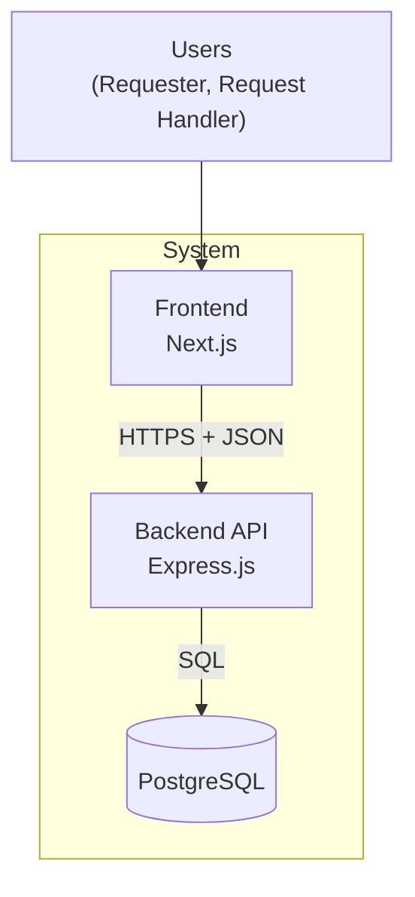
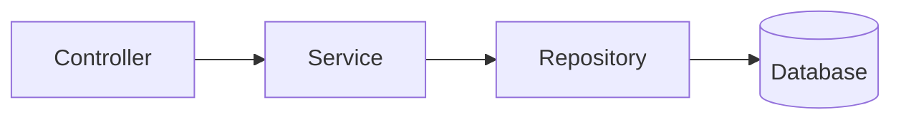

# Architecture: Service Request Management System

**Related:** [requirements.md](requirements.md) · [data-model.md](data-model.md) · [api-contract.md](api-contract.md) · [ADR-001](decisions/ADR-001-architecture.md)

## 1. Overview

The system is a **modular monolith**: one Next.js frontend, one Express.js backend API, and one PostgreSQL database. The backend is split into layers (controller, service, repository) so each part has one job. There are no external services in the MVP.

## 2. Architecture diagram

| Part | Responsibility |
|---|---|
| Frontend | Screens, forms, API calls, loading / empty / error states |
| Backend API | Routing, server-side validation, business rules, error handling |
| Database | Stores requests, enforces constraints, runs migrations |

External dependencies: none.

## 3. Backend layers

| Layer | Does | Does not |
|---|---|---|
| Controller | Handles HTTP, validates input, returns status codes | Contain business rules or SQL |
| Service | Applies business rules (e.g. valid status transitions) | Know about HTTP |
| Repository | Reads and writes the database | Make business decisions |

**Where things belong**
- **Validation:** on the server (controller). The frontend also checks, but only for convenience.
- **Business rules:** in the service.
- **Persistence:** in the repository.

## 4. Request flow: create a request

1. The requester fills in the form and clicks Submit.
2. The frontend sends `POST /api/requests` with JSON.
3. The controller validates the input. If invalid, it returns `400` with an error message.
4. The service sets the status to `OPEN`.
5. The repository saves the request in the database.
6. The API returns `201 Created` with the new request.
7. The frontend shows success and refreshes the list (or shows an error if the call fails).

## 5. Why this architecture fits

- It is the right size for a small two-week project. Microservices would add network, deployment and monitoring costs the project does not need.
- Each layer has one job, so the code is easy to read and test.
- Business rules live in the service, so they can be tested without a database or HTTP.

## 6. Trade-off and risk

**Trade-off:** a single backend is simple to build and debug, but it cannot be scaled or deployed in separate parts. That is acceptable for this scope.

**Known risk:** the MVP has no authentication, so anyone who can open the app can change any request. It is for local/training use only, and authentication is planned as future work (F-01).
