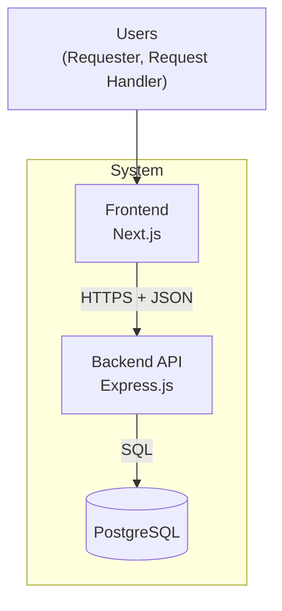
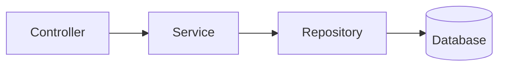

# Architecture: Service Request Management System

**Related:** [requirements.md](requirements.md) · [data-model.md](data-model.md) · [api-contract.md](api-contract.md) · [ADR-001](decisions/ADR-001-architecture.md)

## 1. Overview

The system is a **modular monolith**: one Next.js frontend, one Express.js backend API, and one PostgreSQL database. The backend is split into layers (controller, service, repository) so each part has one job. There are no external services in the MVP.

## 2. Architecture diagram

| Part | Responsibility |
|---|---|
| Frontend | Screens, forms, API calls, loading / empty / error states |
| Backend API | Routing, server-side validation, business rules, error handling |
| Database | Stores requests, enforces constraints, runs migrations |

External dependencies: none.

## 3. Backend layers

| Layer | Does | Does not |
|---|---|---|
| Controller | Handles HTTP, validates input, returns status codes | Contain business rules or SQL |
| Service | Applies business rules (e.g. valid status transitions) | Know about HTTP |
| Repository | Reads and writes the database | Make business decisions |

**Where things belong**
- **Validation:** on the server (controller). The frontend also checks, but only for convenience.
- **Business rules:** in the service.
- **Persistence:** in the repository.

## 4. Request flow: create a request

1. The requester fills in the form and clicks Submit.
2. The frontend sends `POST /api/requests` with JSON.
3. The controller validates the input. If invalid, it returns `400` with an error message.
4. The service sets the status to `OPEN`.
5. The repository saves the request in the database.
6. The API returns `201 Created` with the new request.
7. The frontend shows success and redirects to the list (or shows a field error or submit error if the call fails).

## 5. Request flow: update a status

1. The user clicks "Start progress" on the details page.
2. `StatusActions` component calls `useRequestStatus()`, which calls `updateRequestStatus` in `api.ts`.
3. `api.ts` sends `PATCH /api/requests/{id}/status` with `{ "status": "IN_PROGRESS" }`.
4. The browser sends a CORS preflight (`OPTIONS`), which the backend answers using the `cors` middleware.
5. `routes.ts` passes the request to the controller, which validates the id and body with Zod.
6. The service loads the current request (404 if missing), checks the transition table (`OPEN → IN_PROGRESS` is allowed), and calls the repository.
7. The repository runs `UPDATE requests SET status = $2, updated_at = now() WHERE id = $1 AND status = $3 RETURNING *` — the `AND status = $3` prevents concurrent requests from skipping a step.
8. The controller responds `200` with the updated request object.
9. The UI updates the status badge and metadata from the response. On any failure the error is displayed and the displayed status is unchanged.

## 6. Why this architecture fits

- It is the right size for a small two-week project. Microservices would add network, deployment and monitoring costs the project does not need.
- Each layer has one job, so the code is easy to read and test.
- Business rules live in the service, so they can be tested without a database or HTTP.

## 7. CORS

The frontend (port 3000) and backend (port 4000) are served from different origins. Without CORS headers the browser blocks every cross-origin request, including the `OPTIONS` preflight the browser sends before a `PATCH`.

The `cors` npm package is registered in `app.ts` **before** any routes. It reads the allowed origin from the `CORS_ORIGIN` environment variable (`http://localhost:3000` by default) and permits `GET`, `POST`, `PATCH` and `OPTIONS`. Wildcards (`*`) are not used.

A Next.js reverse proxy was considered as an alternative (avoids the need for CORS entirely) but was rejected because it hides the real API URL from the developer and makes Postman testing harder to set up.

## 8. Trade-off and risk

**Trade-off:** a single backend is simple to build and debug, but it cannot be scaled or deployed in separate parts. That is acceptable for this scope.

**Known risk:** the MVP has no authentication, so anyone who can open the app can change any request. It is for local/training use only, and authentication is planned as future work (F-01).

## 9. Security and cross-cutting concerns (Day 09)

### Security headers

`helmet` is registered as the first middleware in `app.ts` before CORS and routes. It sets `X-Content-Type-Options: nosniff`, removes `X-Powered-By`, and applies a set of other safe default headers. No Content-Security-Policy customisation is needed because the backend returns only JSON.

### Body size limit

`express.json({ limit: '10kb' })` caps incoming JSON bodies. A body larger than 10 kb raises a 413 error handled by `errorHandler`, which returns `{ error: { code: "PAYLOAD_TOO_LARGE", ... } }` with no internal details.

### Structured request logging

`pino` and `pino-http` produce one JSON line per request containing method, URL, status code and response time. Rules enforced in `request-logger.ts`:
- Request bodies, `Authorization` headers, cookies, and the connection string are never logged.
- Log level is read from `LOG_LEVEL` (default `info`).
- All output is suppressed (`silent`) when `NODE_ENV=test` so test output stays readable.
- Unexpected errors are logged with error type and message only — no stack traces or internal paths reach the response.

### Startup configuration validation

`config/environment.ts` validates every required variable at startup and calls `process.exit(1)` with a descriptive message if a variable is missing or invalid. The message names the variable but never prints its value. `TEST_DATABASE_URL` is only checked by the test setup, not by the application itself.
