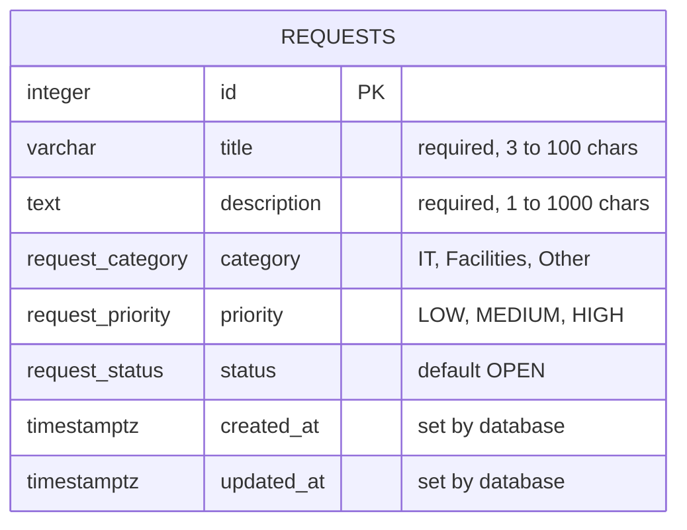

# Data Model: Service Request Management System

**Related:** [requirements.md](requirements.md) · [architecture.md](architecture.md) · [api-contract.md](api-contract.md)

## 1. Overview

The MVP uses **one table**, `requests`. Category, priority and status are fixed lists of values, so they are stored as **enums** instead of separate tables. This keeps the database simple.

Because there is only one table, there are no foreign keys. Future features would add related tables (see section 6).

## 2. ER diagram



## 3. Table: `requests`

| Column | Type | Rules |
|---|---|---|
| `id` | integer | Primary key, auto-increment |
| `title` | varchar(100) | Required. Whitespace trimmed. 3 to 100 characters |
| `description` | text | Required. 1 to 1000 characters |
| `category` | enum | Required. `IT`, `Facilities` or `Other` |
| `priority` | enum | Required. `LOW`, `MEDIUM` or `HIGH` |
| `status` | enum | Required. `OPEN`, `IN_PROGRESS`, `RESOLVED` or `CLOSED`. Default `OPEN` |
| `created_at` | timestamptz | Required. Set by the database when the row is created |
| `updated_at` | timestamptz | Required. Set when the row is created and updated when the status changes |

## 4. Enums

| Enum | Values |
|---|---|
| `request_category` | `IT`, `Facilities`, `Other` |
| `request_priority` | `LOW`, `MEDIUM`, `HIGH` |
| `request_status` | `OPEN`, `IN_PROGRESS`, `RESOLVED`, `CLOSED` |

## 5. Constraints and indexes

**Constraints**
- `id` is the primary key.
- All columns are `NOT NULL`.
- Enums make sure only allowed values can be saved.
- `title` must be 3 to 100 characters after trimming.
- `description` must be 1 to 1000 characters.

**Index**
- `idx_requests_status` on `status`, because the list is filtered by status (US-02).

**Status transitions**

The database cannot control which status can follow which. The **service layer** does this (NFR-09). Allowed transitions:

| From | To |
|---|---|
| `OPEN` | `IN_PROGRESS` |
| `IN_PROGRESS` | `RESOLVED` |
| `RESOLVED` | `CLOSED` |

Any other change is rejected.

## 6. Future tables

These are not part of the MVP.

| Future item | Possible new table | Relationship |
|---|---|---|
| F-01 Authentication and roles | `users` | One user has many requests |
| F-04 Comments | `comments` | One request has many comments |
| F-10 Audit log | `request_history` | One request has many history rows |

## 7. Why one table

- The MVP has only one thing to store: a service request.
- Category, priority and status are short, fixed lists, so enums are enough.
- Fewer tables means simpler queries and less code to test.
- If the values ever need to be edited at runtime, they can be changed into lookup tables later with a migration.

## 8. DBML (for dbdiagram.io)

Use [dbdiagram.io](https://dbdiagram.io/d) to generate the diagram and export it as `evidence/Day-02/data-model.png`.

```dbml
Enum request_category {
  IT
  Facilities
  Other
}

Enum request_priority {
  LOW
  MEDIUM
  HIGH
}

Enum request_status {
  OPEN
  IN_PROGRESS
  RESOLVED
  CLOSED
}

Table requests {
  id integer [pk, increment]
  title varchar(100) [not null, note: '3 to 100 characters']
  description text [not null, note: '1 to 1000 characters']
  category request_category [not null]
  priority request_priority [not null]
  status request_status [not null, default: 'OPEN']
  created_at timestamptz [not null, default: `now()`]
  updated_at timestamptz [not null, default: `now()`]

  indexes {
    status [name: 'idx_requests_status']
  }
}
```
